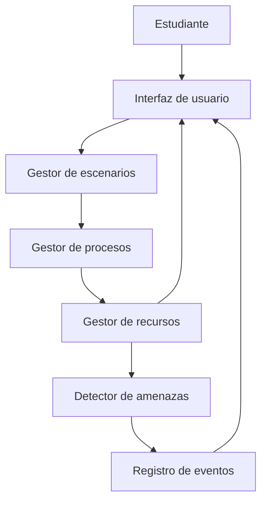
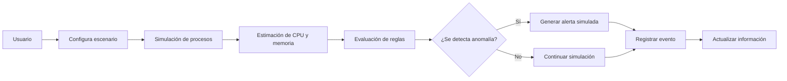
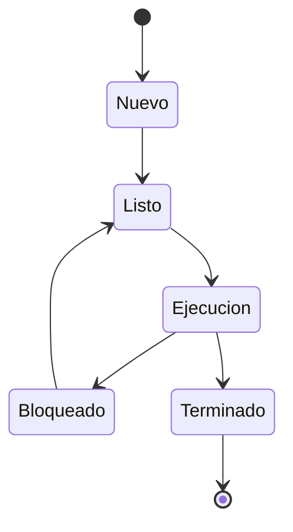

# Arquitectura inicial

## Estilo arquitectónico
Se propone una arquitectura modular por responsabilidades. La interfaz será el punto de interacción con el usuario y se comunicará con módulos especializados.

## Componentes
| Componente | Responsabilidad | Tecnología prevista |
|---|---|---|
| Interfaz de usuario | Presentar información, alertas y controles | Python / Tkinter o PyQt5 |
| Gestor de procesos | Administrar procesos simulados y sus estados | Python |
| Detector de amenazas | Evaluar reglas y reconocer patrones simulados | Python |
| Gestor de recursos | Calcular uso ficticio de CPU y memoria | Python |
| Registro de eventos | Almacenar eventos y alertas | JSON / TXT |
| Gestor de escenarios | Configurar simulaciones didácticas | Python |

## Diagrama de arquitectura

## Diagrama de funcionamiento

## Ciclo de vida de proceso simulado

## Restricción de seguridad
Los procesos serán objetos internos de la simulación. El proyecto no leerá, modificará ni finalizará procesos reales del sistema operativo, ni ejecutará amenazas reales.