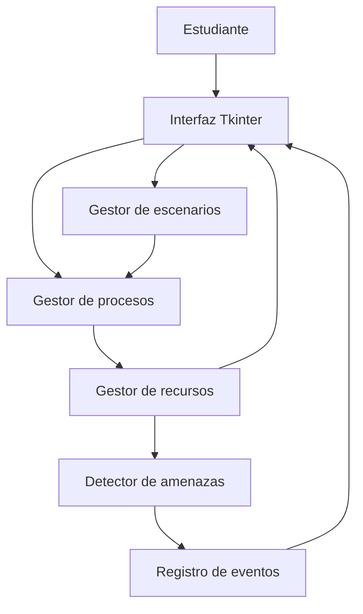
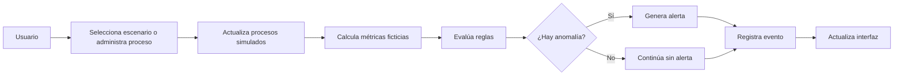
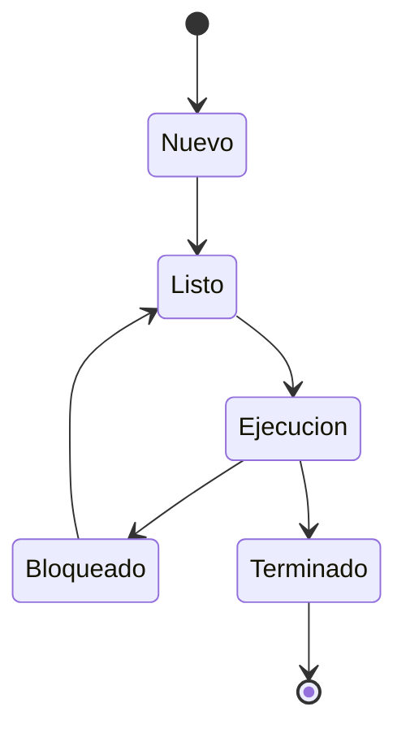

# Arquitectura del proyecto

## Enfoque
CyberShield utiliza una arquitectura modular por responsabilidades. La interfaz Tkinter coordina componentes independientes para la gestión de procesos simulados, agregación de recursos, evaluación de reglas, escenarios y registro de eventos.

Este documento conserva la arquitectura planteada inicialmente y aclara las tecnologías realmente implementadas en el prototipo.

## Componentes implementados

| Componente | Responsabilidad | Archivo principal |
|---|---|---|
| Interfaz | Mostrar tabla, métricas, controles y alertas | `src/interfaz/ventana_principal.py` |
| Punto de entrada | Iniciar la aplicación | `src/main.py` |
| Gestor de procesos | Crear procesos ficticios y validar sus estados | `src/procesos/gestor_procesos.py` |
| Gestor de recursos | Agregar CPU y memoria simuladas | `src/recursos/gestor_recursos.py` |
| Detector de amenazas | Evaluar reglas didácticas | `src/seguridad/detector_amenazas.py` |
| Simulador de escenarios | Preparar escenarios normales y sospechosos | `src/escenarios/simulador_escenarios.py` |
| Registro de eventos | Guardar eventos en JSONL | `src/eventos/registro_eventos.py` |

## Diagrama de arquitectura

## Flujo de funcionamiento

## Ciclo de vida didáctico

## Tecnologías
La interfaz implementada utiliza Python/Tkinter. No se utiliza PyQt5 en la versión actual. El dashboard web `index.html` es una demostración independiente.

## Límite de seguridad y alcance
Los procesos, PID y métricas son datos de simulación. El sistema no consulta ni manipula procesos reales, no ejecuta malware y no realiza detección sobre el equipo anfitrión.
